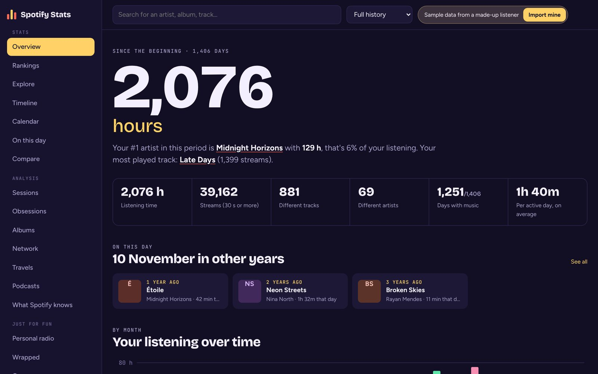
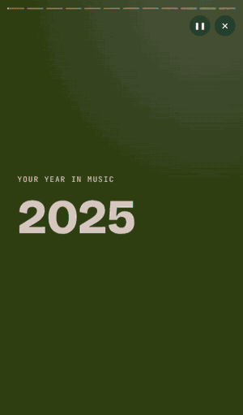
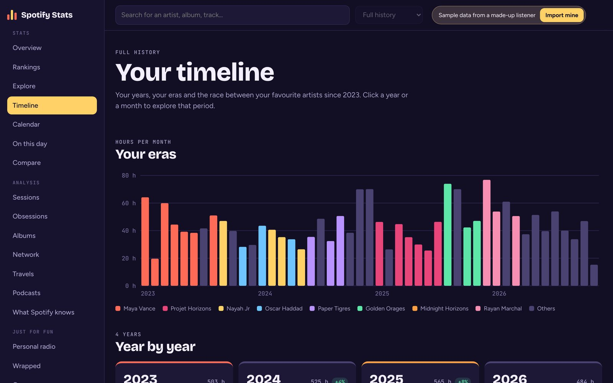
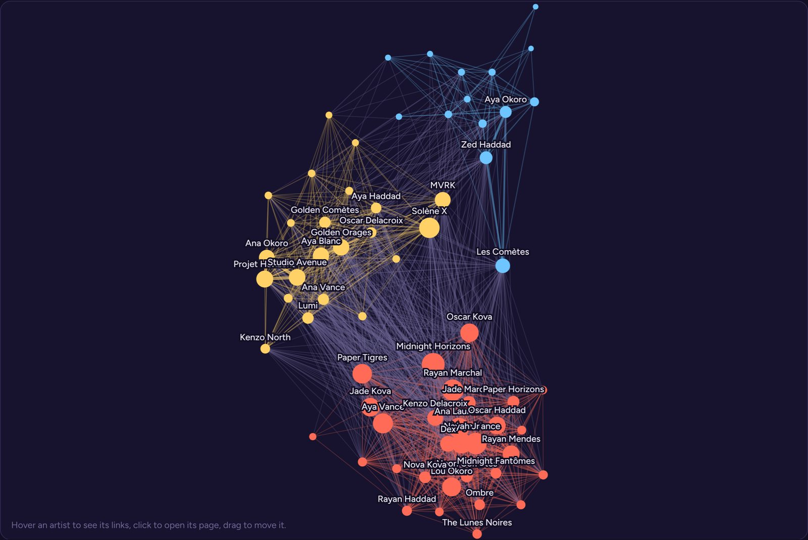
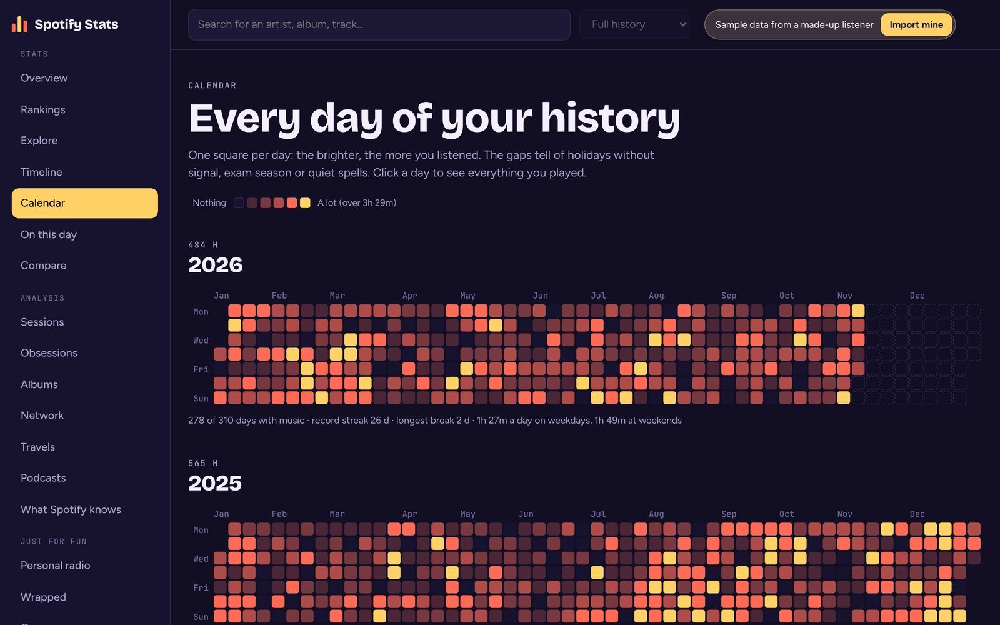
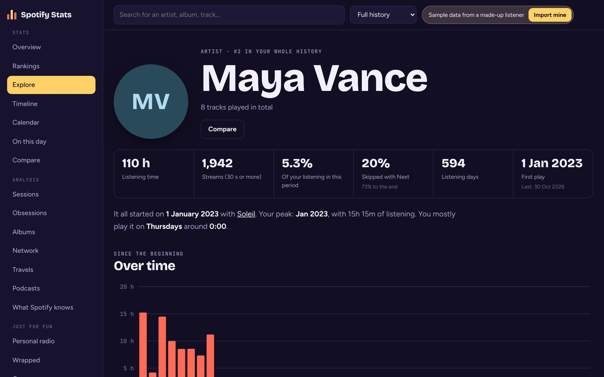
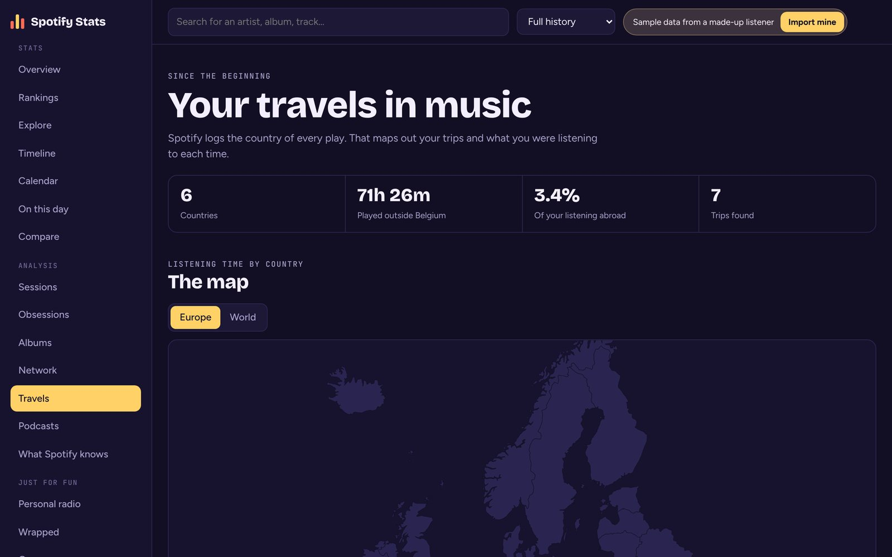
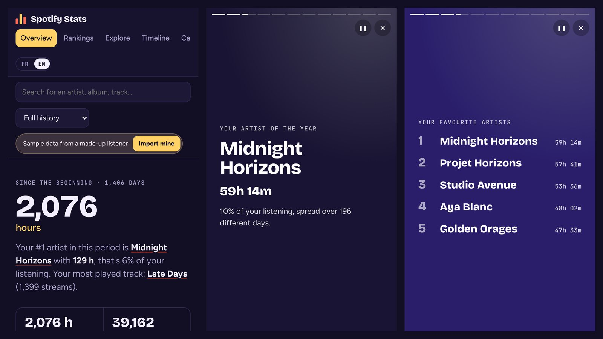

<p align="right"><a href="README.md">Français</a> · <b>English</b></p>

# Spotify Stats

**Your entire Spotify history, finally readable.** Drop the zip Spotify sends you and the site
works everything out: top lists by year, musical eras, a day-by-day calendar, sessions, an
artist network, an animated Wrapped-style recap… all the way back to when you opened your
account.

**Your data never leaves your device.** The file is read and analysed inside the page: there is
no server, nothing is sent anywhere.

<p>
  <a href="https://melcoloy.github.io/spotify-stats-web/?lang=en"><b>Open the site</b></a> ·
  <a href="https://melcoloy.github.io/spotify-stats-web/?demo&lang=en"><b>Try the demo</b></a> (made-up listener, nothing to import) ·
  <a href="#get-your-spotify-export">Get your export</a>
</p>



> Independent project, not affiliated with Spotify. Available in English and French.

## Preview

<table>
  <tr>
    <td width="34%" valign="top"><br><sub>A story-style recap for every year</sub></td>
    <td valign="top"><br><sub>Your eras: each month takes the colour of your #1 artist</sub><br><br>
      <br><sub>Artists you play together, grouped into communities</sub></td>
  </tr>
</table>

<table>
  <tr>
    <td width="50%" valign="top"><br><sub>Every day of your history</sub></td>
    <td width="50%" valign="top"><br><sub>A page for every artist, album and track</sub></td>
  </tr>
  <tr>
    <td width="50%" valign="top"><br><sub>The countries you listened from</sub></td>
    <td width="50%" valign="top"><br><sub>Made for phones too</sub></td>
  </tr>
</table>

## What's inside

**Stats**
- **Overview**: listening time, streams, different artists and tracks, comparison with the
  previous period, month-by-month listening coloured by top artist, top 10s, day × hour
  heatmap, habits (Next button, shuffle, devices), discoveries.
- **Rankings**: all your artists, tracks and albums, sortable and filterable.
- **Explore** and **artist / album / track pages**: listening curve, first play, favourite
  hours, biggest days, what you play before and after a track.
- **Timeline**: your musical eras, a card per year, a forecast of the current year, your #1
  month by month, the race between your artists.
- **Calendar**, **Day** and **On this day**: every day of your history.
- **Compare**: two periods or two artists side by side.

**Analysis**
- **Sessions**: length, start times, how your tracks start and stop.
- **Obsessions**: tracks played on repeat for a week, half-life, classics.
- **Albums**: albums played start to finish, one-song albums.
- **Network**: graph of artists played together, communities (Louvain algorithm).
- **Travels**: map of the countries you listened from, trips detected automatically.
- **Podcasts**: shows and episodes.
- **What Spotify knows**: with the "Account data" export, your official Wrapped compared with
  the site's numbers, the taste profile Spotify wrote about you, the ad categories it puts you
  in, your searches, your playlists.

**Just for fun**
- **Personal radio**: a Markov chain learned from your sessions plays tracks the way you would.
- **Wrapped**: a story-style animated recap for each year, exportable as an image.
- **Games**: higher or lower, guess the year, who sings?, blind test, put them in order.

A bar at the top lets you pick the period: full history, a year, the last 30 days or any dates.

**Account hacked?** The site spots tracks played at the same time from different countries and
offers to remove them from your stats.

## Get your Spotify export

1. Go to [spotify.com/account/privacy](https://www.spotify.com/account/privacy/) in a browser.
2. Tick **"Extended streaming history"** and request the data.
3. Confirm through Spotify's email.
4. A few days later (up to 30), download the zip and drop it on the site.

The "Account data" export, on the same page, can be dropped at the same time: it adds the
"What Spotify knows" page and any plays more recent than the end of the extended history. On
its own it only covers the last year, with no albums, devices or countries. The identity and
payment files in that export are never read.

## Using the site

Online: [melcoloy.github.io/spotify-stats-web](https://melcoloy.github.io/spotify-stats-web/?lang=en).
After a first visit, the site also works offline and can be installed as an app (your
browser's install icon).

- `?demo` at the end of the address opens the sample data straight away.
- `?lang=en` or `?lang=fr` forces the language. Otherwise the site follows your browser's
  language, and the FR / EN switch changes it at any time.

Locally: the site uses JavaScript modules, which don't load when you open `index.html`
directly. Start a small server in the folder:

```bash
python -m http.server 8000
```

then open http://localhost:8000.

## Publishing with GitHub Pages

In the GitHub repository: **Settings → Pages → Build and deployment → Source: Deploy from a
branch**, branch `main`, folder `/ (root)`. The site goes live at
`https://<your-username>.github.io/<repo-name>/` after a minute or two.

## How it's built

HTML, CSS and JavaScript, no framework and no build step.

```
index.html          import screen + interface
css/                styles and fonts
fonts/              Bricolage Grotesque, Figtree, JetBrains Mono (OFL licence)
js/importer.js      reads the zip / JSON files and converts them to a compact format
js/store.js         optional local copy in the browser (IndexedDB)
js/demo.js          sample data generator
js/covers.js        cover art via Spotify's public oEmbed, if the browser allows it
js/i18n.js          translation: the French text is the key
js/i18n-en.js       English dictionary
data/world.json     country outlines (Natural Earth, via world-atlas)
sw.js               service worker (offline mode)
js/data.js          all the statistics
js/charts.js        SVG charts
js/views/           one view per page
js/vendor/fflate.js zip decompression (fflate, MIT licence)
docs/               screenshots and the repository preview image
```

### Adding a language

Interface text is written in French in the code, wrapped in ``loc`…` ``. `js/i18n-en.js` maps
each French sentence to its translation, with `{0}`, `{1}`… standing for the values. For a new
language, copy that file, translate the values and register it in `js/i18n.js`. A sentence you
missed shows up in French and is listed in `window.__i18nMissing` in the browser console.

### Definitions

- **Stream**: a play of 30 seconds or more, as Spotify counts it.
- **Skipped**: a track cut short with the Next button.
- **Session**: plays with less than 30 minutes of silence between them.
- **Times**: the browser's time zone at import.
- The same track on several albums (single, deluxe…) is grouped by name and artist.

### Privacy

The only outside contact is optional: to show cover art, the browser asks Spotify for the
images of your most played tracks (using only their public IDs). Offline, the site shows
initials instead.

## Licence

MIT — see [LICENSE](LICENSE).
