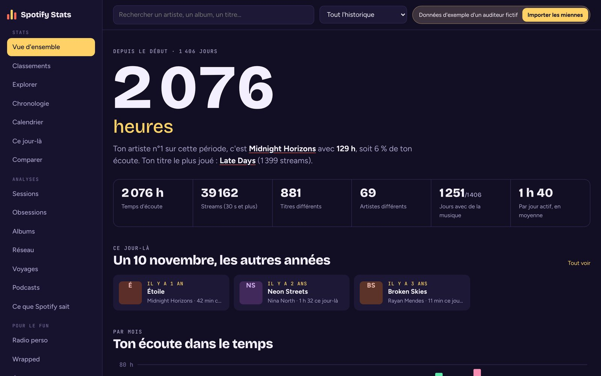
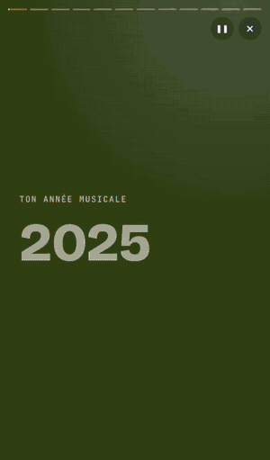
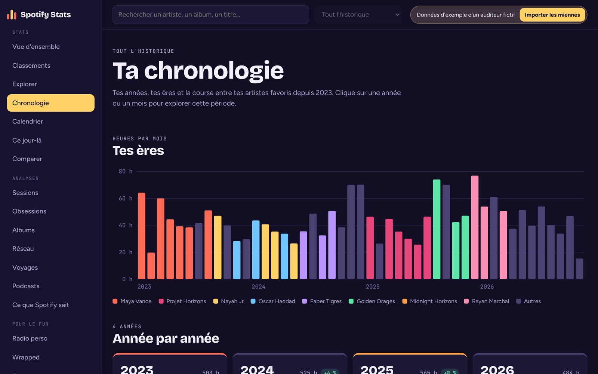
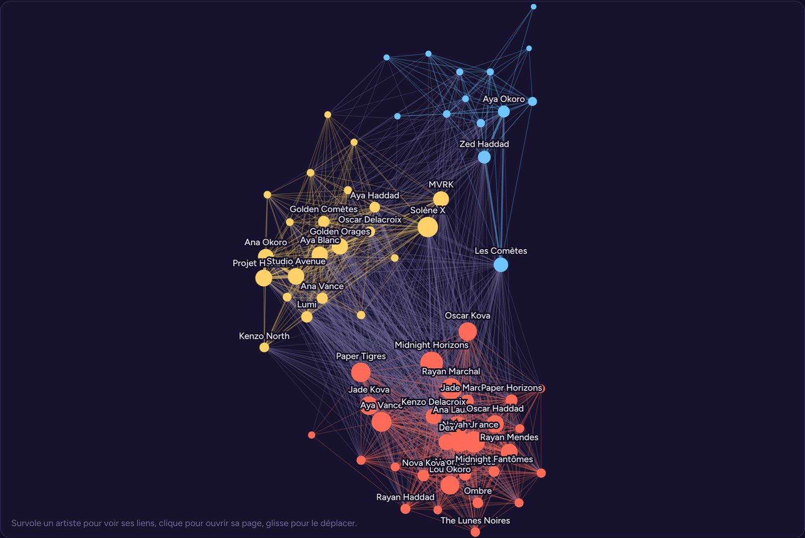
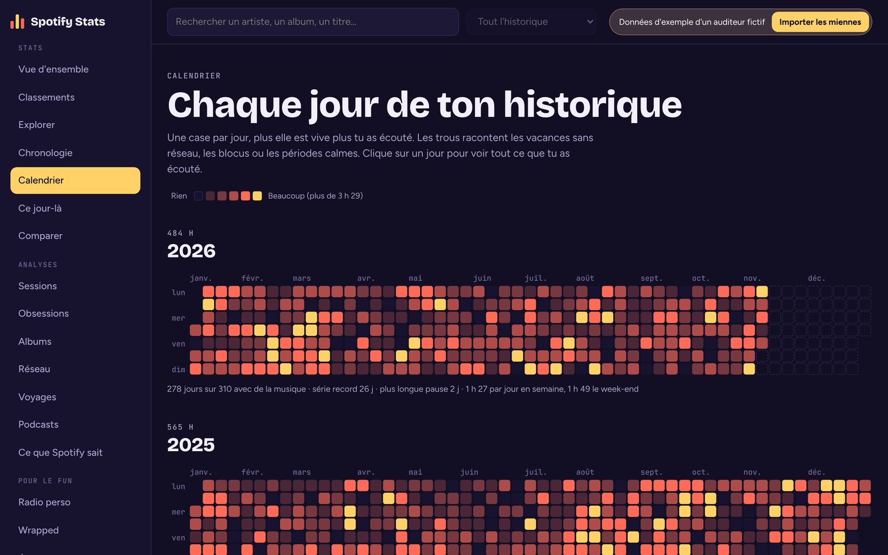
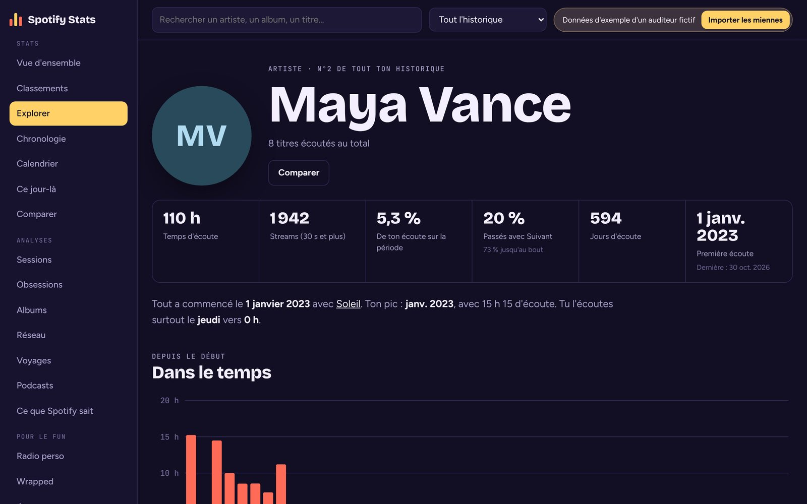
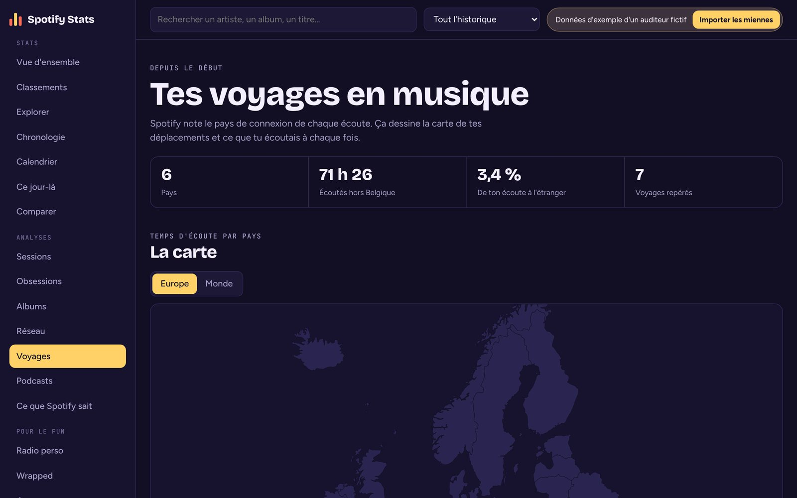
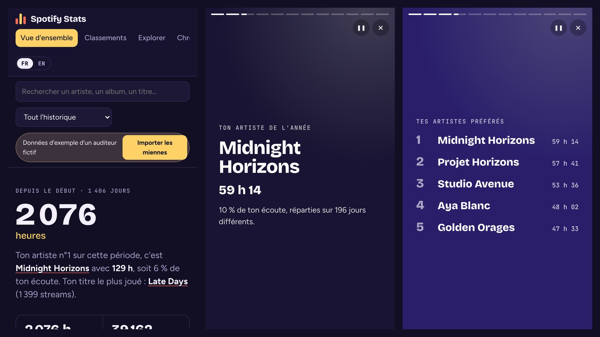

<p align="right"><b>Français</b> · <a href="README.en.md">English</a></p>

# Spotify Stats

**Tout ton historique Spotify, enfin lisible.** Tu déposes le zip que Spotify t'envoie, et le
site calcule tout : tops par année, ères musicales, calendrier jour par jour, sessions, réseau
d'artistes, récap animé façon Wrapped… depuis la création de ton compte.

**Tes données ne quittent jamais ton appareil.** Le fichier est lu et analysé dans la page : il
n'y a pas de serveur, rien n'est envoyé nulle part.

<p>
  <a href="https://melcoloy.github.io/spotify-stats-web/"><b>Ouvrir le site</b></a> ·
  <a href="https://melcoloy.github.io/spotify-stats-web/?demo"><b>Voir la démo</b></a> (auditeur fictif, sans rien importer) ·
  <a href="#obtenir-ton-export-spotify">Obtenir ton export</a>
</p>



> Projet indépendant, non affilié à Spotify. Disponible en français et en anglais.

## Aperçu

<table>
  <tr>
    <td width="34%" valign="top"><br><sub>Le récap façon story, pour chaque année</sub></td>
    <td valign="top"><br><sub>Tes ères : chaque mois prend la couleur de ton artiste n°1</sub><br><br>
      <br><sub>Les artistes que tu écoutes ensemble, regroupés en communautés</sub></td>
  </tr>
</table>

<table>
  <tr>
    <td width="50%" valign="top"><br><sub>Chaque jour de ton historique</sub></td>
    <td width="50%" valign="top"><br><sub>Une page par artiste, album et titre</sub></td>
  </tr>
  <tr>
    <td width="50%" valign="top"><br><sub>Les pays d'où tu as écouté</sub></td>
    <td width="50%" valign="top"><br><sub>Pensé aussi pour le téléphone</sub></td>
  </tr>
</table>

## Ce que tu y trouves

**Stats**
- **Vue d'ensemble** : temps d'écoute, streams, artistes et titres différents, comparaison avec
  la période précédente, écoute mois par mois colorée par artiste dominant, tops 10, carte
  jour × heure, habitudes (bouton Suivant, aléatoire, appareils), découvertes.
- **Classements** : tous tes artistes, titres et albums, triables et filtrables.
- **Explorer** et **pages artiste / album / titre** : courbe d'écoute, première écoute, heures
  préférées, plus grosses journées, ce que tu écoutes avant et après un titre.
- **Chronologie** : tes ères musicales, une carte par année, une projection de ton année en
  cours, ton n°1 mois par mois, la course entre tes artistes.
- **Calendrier**, **Journée** et **Ce jour-là** : chaque jour de ton historique.
- **Comparer** : deux périodes ou deux artistes côte à côte.

**Analyses**
- **Sessions** : durée, heures de démarrage, comment tes titres démarrent et s'arrêtent.
- **Obsessions** : titres écoutés en boucle sur une semaine, demi-vie, classiques.
- **Albums** : albums écoutés d'une traite, albums à un seul titre.
- **Réseau** : graphe des artistes écoutés ensemble, communautés (algorithme de Louvain).
- **Voyages** : carte des pays d'où tu as écouté, voyages repérés automatiquement.
- **Podcasts** : émissions et épisodes.
- **Ce que Spotify sait** : avec l'export « Données du compte », ton Wrapped officiel comparé
  aux calculs du site, le portrait de tes goûts rédigé par Spotify, les catégories
  publicitaires dans lesquelles il te range, tes recherches, tes playlists.

**Pour le fun**
- **Radio perso** : une chaîne de Markov apprise sur tes sessions enchaîne les titres comme toi.
- **Wrapped** : récap animé façon story pour chaque année, exportable en image.
- **Jeux** : plus ou moins, devine l'année, qui chante ?, blind test, remets dans l'ordre.

Une barre en haut de page permet de choisir la période : tout l'historique, une année, les
30 derniers jours ou des dates libres.

**Compte piraté ?** Le site repère les écoutes lancées au même moment depuis des pays
différents et propose de les retirer de tes stats.

## Obtenir ton export Spotify

1. Va sur [spotify.com/account/privacy](https://www.spotify.com/account/privacy/) depuis un navigateur.
2. Coche **« Historique de streaming étendu »** et demande les données.
3. Confirme via l'e-mail de Spotify.
4. Quelques jours plus tard (jusqu'à 30), télécharge le zip et dépose-le sur le site.

L'export « Données du compte », sur la même page, peut être déposé en même temps : il ajoute
la page « Ce que Spotify sait » et les écoutes plus récentes que la fin de l'historique
étendu. Seul, il ne couvre que la dernière année, sans albums, appareils ni pays. Les fichiers
d'identité et de paiement de cet export ne sont jamais lus.

## Utiliser le site

En ligne : [melcoloy.github.io/spotify-stats-web](https://melcoloy.github.io/spotify-stats-web/).
Après une première visite, le site marche aussi hors ligne et peut s'installer comme une appli
(icône d'installation du navigateur).

- `?demo` à la fin de l'adresse ouvre directement les données d'exemple.
- `?lang=en` ou `?lang=fr` force la langue. Sinon, le site suit la langue du navigateur, et le
  bouton FR / EN permet de changer à tout moment.

En local : le site utilise des modules JavaScript, qui ne se chargent pas en ouvrant
`index.html` directement. Lance un petit serveur dans le dossier :

```bash
python -m http.server 8000
```

puis ouvre http://localhost:8000.

## Mettre en ligne avec GitHub Pages

Dans le dépôt sur GitHub : **Settings → Pages → Build and deployment → Source : Deploy from a
branch**, branche `main`, dossier `/ (root)`. Le site est publié à
`https://<ton-pseudo>.github.io/<nom-du-dépôt>/` après une minute ou deux.

## Comment c'est fait

HTML, CSS et JavaScript sans framework ni étape de build.

```
index.html          écran d'import + interface
css/                styles et polices
fonts/              Bricolage Grotesque, Figtree, JetBrains Mono (licence OFL)
js/importer.js      lecture du zip / des JSON et conversion en format compact
js/store.js         copie locale facultative dans le navigateur (IndexedDB)
js/demo.js          générateur de données d'exemple
js/covers.js        pochettes via l'oEmbed public de Spotify, si le navigateur l'autorise
js/i18n.js          traduction : le texte français sert de clé
js/i18n-en.js       dictionnaire anglais
data/world.json     contours des pays (Natural Earth, via world-atlas)
sw.js               service worker (mode hors ligne)
js/data.js          calcul de toutes les statistiques
js/charts.js        graphiques SVG
js/views/           une vue par page
js/vendor/fflate.js décompression du zip (fflate, licence MIT)
docs/               captures d'écran et image d'aperçu du dépôt
```

### Ajouter une langue

Les textes de l'interface sont écrits en français dans le code, entourés de ``loc`…` ``.
`js/i18n-en.js` associe chaque phrase française à sa traduction, avec `{0}`, `{1}`… à la place
des valeurs. Pour une nouvelle langue : copie ce fichier, traduis les valeurs, puis ajoute-le
dans `js/i18n.js`. Une phrase oubliée s'affiche en français et apparaît dans
`window.__i18nMissing`, dans la console du navigateur.

### Définitions

- **Stream** : une écoute de 30 secondes ou plus, comme Spotify.
- **Passé** : un titre interrompu avec le bouton Suivant.
- **Session** : des écoutes séparées de moins de 30 minutes de silence.
- **Heures** : fuseau horaire du navigateur au moment de l'import.
- Un même titre présent sur plusieurs albums (single, deluxe…) est regroupé par nom et artiste.

### Confidentialité

Le seul contact avec l'extérieur est facultatif : pour afficher les pochettes, le navigateur
demande à Spotify l'image de tes titres les plus écoutés (uniquement leurs identifiants
publics). Sans réseau, le site affiche des initiales à la place.

## Licence

MIT — voir [LICENSE](LICENSE).
